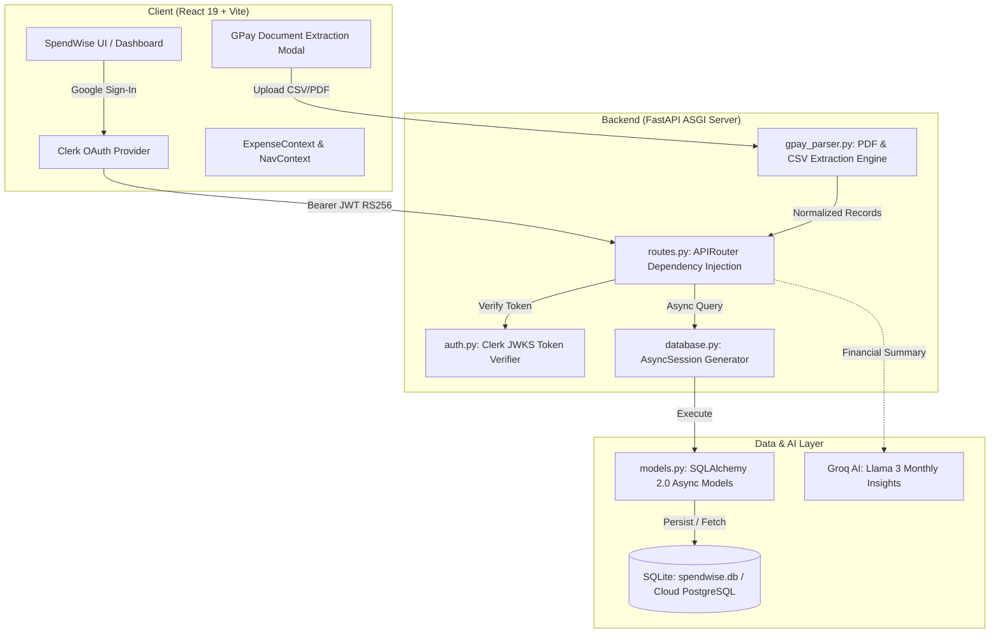

# 💸 SpendWise — Intelligent Expense Tracker & UPI Document Intelligence

<p align="center">
  
  
  
  
  
  
  
</p>

---

## 📌 Executive Summary

**SpendWise** is a modern, full-stack personal finance application designed to eliminate the manual friction of expense logging and provide deep visual intelligence on monthly spending behavior.

Built with an asynchronous **FastAPI + SQLAlchemy 2.0** backend and a **React 19 + Tailwind CSS** frontend, SpendWise features an automated **Google Pay (GPay) & UPI Statement Extraction Engine** that parses raw PDF/CSV transaction statements, cleans merchant titles, automatically categorizes expenses using intelligent heuristics, and updates real-time analytics in sub-seconds.

---

## 🎯 The Problems SpendWise Solves

| Problem | Traditional Solution | SpendWise Solution |
| :--- | :--- | :--- |
| **Manual Logging Fatigue** | Typing every ₹20 chai, ₹150 Swiggy order by hand. Users quit tracking after 4 days. | **1-Click Statement Ingestion**: Upload GPay/UPI PDF or CSV statement. The parser extracts date, amount, merchant, and auto-tags category with deduplication. |
| **Multi-Month Budget Contamination** | Updating budget in October overwrites August records. | **Strict Relational Month Scoping**: Unique database constraint (`user_id`, `month`) guarantees each calendar month's budget is strictly isolated. |
| **Cross-Account Privacy Leaks** | Shared browser caches leak notifications between Google accounts. | **Namespaced Multi-Tenant Caching**: Browser storage and API calls are strictly scoped by Clerk `userId`. |
| **Database Fragility** | Schemaless document stores allowing inconsistent data types. | **SQLAlchemy 2.0 Async ORM**: Type-enforced schema, foreign-key readiness, and instant zero-downtime portability between SQLite and PostgreSQL. |

---

## 🚀 Key Features

### 1. 📄 Automated GPay / UPI Statement Ingestion
- **Multi-Format Parsing**: Extracts structured transactions from Google Pay export CSVs and bank-generated UPI PDF statements.
- **Smart Category Heuristics**: Automatically detects transaction categories:
  - 🍔 *Food*: Swiggy, Zomato, McDonald's, Blinkit, Zepto, Cafe, Restaurant, Chai
  - 🚗 *Transport*: Uber, Ola, Rapido, Metro, Fuel, Petrol, Shell, Indian Oil
  - 🛍️ *Shopping*: Amazon, Flipkart, Myntra, Zara, Reliance, Dmart
  - 🎬 *Entertainment*: BookMyShow, Netflix, Spotify, Prime, Hotstar, Gaming
  - 💡 *Utilities*: Bescom, Electricity, Airtel, Jio, Wi-Fi, Water, Gas
- **Preview & Verification Stage**: Shows transactions in a clean modal where users can toggle selections, review parsed amounts, and tweak categories before committing.
- **Built-in Deduplication**: Prevents duplicate transactions if statements have overlapping date ranges.

### 2. 📊 Dynamic Visual Analytics & Multi-Range Trends
- **Four Timeframe Perspectives**: Daily, Weekly, Monthly, and Yearly trend visualizations powered by Recharts & Chart.js.
- **Category Spending Breakdown**: Interactive donut chart visualizing spending distribution across categories.
- **Real-Time Balance Tracker**: Dynamic calculation of Total Monthly Income vs. Total Spent vs. Remaining Balance.

### 3. 🎯 Isolated Monthly Budgeting & Alert System
- Set custom income and allocated category budgets per calendar month.
- Visual progress bars showing percentage consumed per category.
- Proactive warning threshold alerts when spending exceeds budget limits.

### 4. 🔒 Enterprise Security & Asymmetric Authentication
- **Clerk OAuth & JWT**: Passwordless Google Sign-In using RS256 asymmetric cryptographic tokens.
- **JWKS Key Verification**: Backend validates JWT signatures using Clerk's public key sets without sharing master secrets.
- **Row-Level User Isolation**: Every database query is strictly filtered by the authenticated user's unique Clerk ID.

---

## 🏗️ System Architecture



---

## 💻 Tech Stack

### Frontend
- **Framework**: [React 19](https://react.dev/) + [Vite](https://vitejs.dev/)
- **Styling**: [Tailwind CSS v4](https://tailwindcss.com/)
- **Charts & Visualization**: [Recharts](https://recharts.org/) & [Chart.js](https://www.chartjs.org/)
- **Icons & Motion**: [Lucide React](https://lucide.dev/) & [Framer Motion](https://www.framer.com/motion/)
- **Notifications**: [Sonner](https://sonner.emilkowal.ski/)
- **Authentication**: [@clerk/clerk-react](https://clerk.com/)

### Backend
- **Framework**: [FastAPI](https://fastapi.tiangolo.com/) (Python 3.11+)
- **Server**: [Uvicorn](https://www.uvicorn.org/) (ASGI)
- **ORM**: [SQLAlchemy 2.0](https://www.sqlalchemy.org/) (Async declarative)
- **Database Engine**: [SQLite](https://www.sqlite.org/) via `aiosqlite` (ready for PostgreSQL via `asyncpg`)
- **Document Processing**: `pypdf`, `python-multipart`, `python-dateutil`
- **Security & Cryptography**: `PyJWT`, `cryptography` (RS256 asymmetric verification)
- **AI Integration**: [Groq Cloud SDK](https://console.groq.com/) (Llama-3.1-8b-instant)

---

## 📁 Repository Structure

```text
Expense Tracker Appln/
├── backend/
│   ├── app.py                 # FastAPI application & lifespan manager
│   ├── auth.py                # Clerk RS256 asymmetric JWKS authentication
│   ├── database.py            # Async engine, sessionmaker & DB dependency
│   ├── gpay_parser.py         # Google Pay & UPI PDF/CSV parsing heuristics
│   ├── models.py              # SQLAlchemy 2.0 declarative database models
│   ├── routes.py              # REST API route handlers
│   ├── schemas.py             # Pydantic request & response validation
│   ├── ai_services.py         # Groq LLM integration service
│   ├── run.py                 # Direct startup runner
│   ├── requirements.txt       # Backend Python dependencies
│   └── spendwise.db           # Local SQLite database file
├── frontend/
│   └── my-project/
│       ├── src/
│       │   ├── components/
│       │   │   ├── GPayUploadModal.jsx  # Statement upload & preview modal
│       │   │   ├── Navbar.jsx           # Global top navigation
│       │   │   └── ...
│       │   ├── context/
│       │   │   ├── Expensecontent.jsx   # Expenses state & backend sync
│       │   │   └── Navcontent.jsx       # Budget & notifications context
│       │   ├── pages/
│       │   │   ├── Dashboard.jsx        # Analytics charts & quick metrics
│       │   │   ├── Expense.jsx          # Manual expense logger
│       │   │   ├── Transactions.jsx     # Transaction list & GPay import
│       │   │   ├── Budget.jsx           # Monthly category budgets
│       │   │   ├── Categories.jsx       # Category breakdown
│       │   │   ├── HomePage.jsx         # Status overview & AI insights
│       │   │   └── AuthPage.jsx         # Clerk sign-in / sign-up screen
│       │   ├── App.jsx                  # Main router setup
│       │   └── main.jsx                 # ClerkProvider application root
│       ├── package.json
│       └── vite.config.js
├── README.md                  # Project overview & documentation
└── INTERVIEW_STUDY_GUIDE.md   # Full-Stack interview architecture guide
```

---

## ⚙️ Installation & Local Setup

### Prerequisites
- **Node.js**: v18.0 or higher
- **Python**: v3.11 or higher
- **Clerk Account**: For authentication keys ([clerk.com](https://clerk.com))
- **Groq API Key**: Optional, for AI features ([groq.com](https://groq.com))

---

### Step 1: Clone the Repository
```bash
git clone https://github.com/GOKULSIVA123/spendwise_01.git
cd "Expense Tracker Appln"
```

---

### Step 2: Backend Setup
```bash
cd backend

# Create and activate a Python virtual environment
python -m venv .venv

# Windows:
.venv\Scripts\activate
# macOS/Linux:
# source .venv/bin/activate

# Install dependencies
pip install -r requirements.txt
```

Create a `.env` file in the `backend/` folder:
```env
# Database (defaults to local SQLite if left empty)
DATABASE_URL=sqlite+aiosqlite:///./spendwise.db

# Clerk Authentication (From Clerk Dashboard -> API Keys)
CLERK_FRONTEND_API_URL=https://your-app.clerk.accounts.dev
CLERK_SECRET_KEY=sk_test_...

# Groq AI
GROQ_API_KEY=gsk_...
```

Start the FastAPI backend:
```bash
uvicorn app:app --reload --port 8000
```
*API docs available at: `http://127.0.0.1:8000/docs`*

---

### Step 3: Frontend Setup
Open a new terminal:
```bash
cd frontend/my-project

# Install dependencies
npm install
```

Create a `.env` file in `frontend/my-project/`:
```env
# Clerk Publishable Key
VITE_CLERK_PUBLISHABLE_KEY=pk_test_...

# Backend API Base URL
VITE_API_BASE_URL=http://127.0.0.1:8000
```

Start the Vite development server:
```bash
npm run dev
```
*Frontend running at: `http://localhost:5173`*

---

## 📡 REST API Reference

| Method | Endpoint | Description | Auth Required |
| :--- | :--- | :--- | :---: |
| `GET` | `/api/health_check` | Service & database connectivity check | ❌ |
| `GET` | `/api/me` | Returns active user's Clerk ID | ✅ |
| `GET` | `/api/expenses` | Fetch expenses (optional `?month=YYYY-MM`) | ✅ |
| `POST` | `/api/expenses` | Create a new manual expense | ✅ |
| `DELETE` | `/api/expenses/{id}` | Delete an expense by UUID | ✅ |
| `POST` | `/api/expenses/parse-gpay` | Parse GPay statement and preview results | ✅ |
| `POST` | `/api/expenses/bulk-add` | Insert verified list of statement transactions | ✅ |
| `GET` | `/api/budgets` | Fetch monthly budget for a given month | ✅ |
| `POST` | `/api/budget` | Create/update isolated budget for a month | ✅ |
| `GET` | `/api/notifications` | Fetch user-specific notifications | ✅ |
| `POST` | `/api/ai/analyze` | Request AI monthly financial behavior report | ✅ |

---

## 🛡️ Database Schema (SQLAlchemy 2.0)

```sql
-- Expenses Table
CREATE TABLE expenses (
    id VARCHAR(36) PRIMARY KEY,
    user_id VARCHAR(128) NOT NULL,
    title VARCHAR(255) NOT NULL,
    amount FLOAT NOT NULL,
    category VARCHAR(100) NOT NULL,
    date VARCHAR(10) NOT NULL,      -- "YYYY-MM-DD"
    notes TEXT DEFAULT '',
    created_at VARCHAR(35)
);
CREATE INDEX ix_expenses_user_id ON expenses (user_id);
CREATE INDEX ix_expenses_date ON expenses (date);

-- Budgets Table (Strict Multi-Month Isolation)
CREATE TABLE budgets (
    id VARCHAR(36) PRIMARY KEY,
    user_id VARCHAR(128) NOT NULL,
    month VARCHAR(7) NOT NULL,       -- "YYYY-MM"
    income FLOAT DEFAULT 0.0,
    categories JSON DEFAULT '{}',
    updated_at VARCHAR(35),
    CONSTRAINT uq_user_month_budget UNIQUE (user_id, month)
);
```

---

## 🤝 Contributing & License

Contributions are welcome! Please feel free to open a Pull Request or file an issue.

Distributed under the **MIT License**. Created by [Gokul](https://github.com/GOKULSIVA123).
