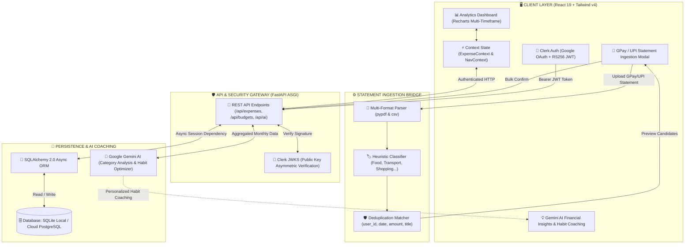

# 💸 SpendWise

> **AI-Powered Financial Habit Optimizer & Smart Expense Tracker**
> *Effortlessly import GPay & UPI statements to fuel real-time analytics and personalized AI financial coaching.*

<p align="left">
  
  
  
  
  
  
</p>

---

## 🎯 What Problems Does SpendWise Solve?

SpendWise is designed around a single core mission: **to help users build better financial habits and stop overspending.** We use instant statement ingestion simply as a bridge to get real financial data onto the dashboard so that Google Gemini AI can deliver deep, personalized coaching.

Here are the five core problems SpendWise solves:

### 1. 🤖 Lack of Guidance to Improve Financial Habits (The Core Mission)
* **The Problem**: Traditional trackers only show historical numbers after money has already left your account. They don't guide you on how to change your behavior, identify budget leaks, or build lasting wealth.
* **SpendWise Solution**: **Gemini AI Category & Overall Habit Coaching**. Google Gemini AI analyzes each individual budget category (*Food, Transport, Shopping, Entertainment, Utilities*) to reveal exact overspending leaks, calculates your overall monthly financial health score, and delivers actionable, personalized daily and weekly habits to help you save and optimize your finances.

### 2. ⚡ Manual Logging Friction (The Data Bridge)
* **The Problem**: Entering every ₹20 chai, ₹150 Swiggy, or fuel transaction by hand is tedious. 80% of users quit tracking within four days.
* **SpendWise Solution**: **1-Click GPay & UPI Statement Upload**. To feed the AI accurate real-world data without user fatigue, users can simply upload a Google Pay or bank statement (CSV or PDF). SpendWise cleans merchant titles, categorizes items, deduplicates, and syncs them to the dashboard in seconds.

### 3. 📅 Multi-Month Budget Overwriting
* **The Problem**: In typical apps, editing your monthly budget retroactively overwrites past months, corrupting historical tracking and distorting AI analysis.
* **SpendWise Solution**: **Strict Relational Month Scoping**. An isolated compound database constraint (`user_id`, `month`) ensures each calendar month's budget is independently stored and never contaminated.

### 4. 🔍 Financial Blindspots & Guesswork
* **The Problem**: Basic trackers show a single number: "You spent ₹X". Users can't see trends or spending spikes across different cycles.
* **SpendWise Solution**: **Interactive Multi-Timeframe Analytics**. Live dynamic visualizations powered by Recharts across **Daily, Weekly, Monthly, and Yearly** intervals, alongside proactive category overspending threshold alerts.

### 5. 🔒 Cross-Account Data Leaks on Shared Devices
* **The Problem**: When family members or colleagues share a device, browser caching often leaks transaction notifications between Google accounts.
* **SpendWise Solution**: **Row-Level JWT Isolation & Namespaced Caching**. Every API request is verified with asymmetric RS256 Clerk tokens, database queries are strictly scoped to the active user ID, and all browser caches are namespaced per user.

---

## 🏗️ System Architecture



---

## 🚀 Quick Start (Local Setup)

### 1. Backend (FastAPI + Python 3.11+)
```bash
cd backend
python -m venv .venv

# Activate virtual environment
.venv\Scripts\activate      # Windows
# source .venv/bin/activate # macOS/Linux

pip install -r requirements.txt
uvicorn app:app --reload --port 8000
```
*API running at: `http://127.0.0.1:8000` (Swagger docs at `/docs`)*

### 2. Frontend (React 19 + Vite)
```bash
cd frontend/my-project
npm install
npm run dev
```
*App running at: `http://localhost:5173`*

---

## 🛠️ Tech Stack at a Glance

* **Frontend**: React 19, Tailwind CSS v4, Recharts, Framer Motion, Lucide Icons
* **Backend**: FastAPI (Python), SQLAlchemy 2.0 (Async), Uvicorn
* **Database**: SQLite (`aiosqlite`) for local dev, ready for PostgreSQL (`asyncpg`) in cloud
* **Authentication**: Clerk RS256 Asymmetric JWT
* **Statement Processing**: `pypdf`, `python-dateutil`
* **AI Intelligence**: Google Gemini AI (Habit Coaching & Category Insights)
